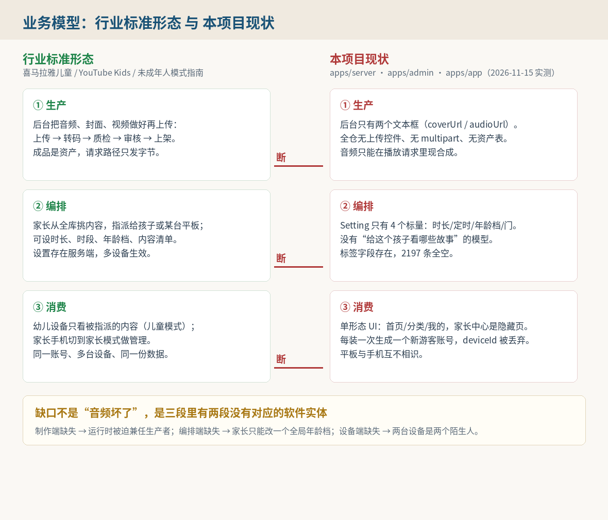
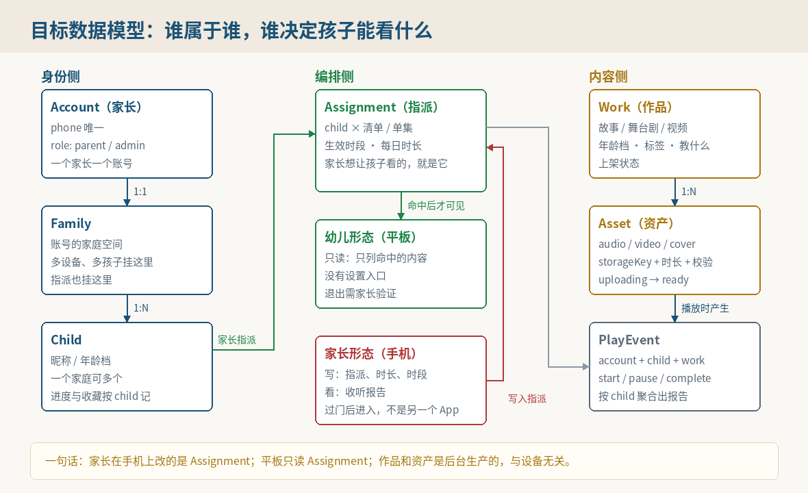

# 小故事铺：业务流程与双形态架构研究

> 研究时间：2026-11-15 | 所属领域：儿童音频内容平台 | 研究对象类型：产品形态与内容生产管线

## 一、先定坐标：这台产品由几段组成

一句话：**小故事铺要成立，需要三段软件——后台生产内容、家长编排内容、幼儿设备消费内容；现在的仓库只有第三段，而且第三段是匿名单形态的。**

这不是我的偏好，是这类产品的通行结构。国家网信办 2024 年 11 月发布的[《移动互联网未成年人模式建设指南》](https://www.cac.gov.cn/2024-11/15/c_1733364304749288.htm)把这件事写成了条款：未成年人模式要「三方联动」、要「一键启动/退出后应用程序自动同步切换」、要「支持家长在多个移动智能终端进行统一设置」、退出必须「家长进行验证同意」、内容按年龄分龄推荐（3 周岁以下推荐音频内容以引导减少屏幕使用）。换成产品语言就是：**一个 App、多种展示形态、家长在一台设备上管另一台设备。**

三段各自的职责，以及现在代码的实际状态：



我把「断」标在三处，不是修辞。三处都能在代码里指到具体位置：

| 段 | 应该有什么 | 代码里有什么 | 证据 |
| --- | --- | --- | --- |
| 生产 | 上传音频/封面/视频、转码、质检、审核、上架 | 两个文本框，没有上传 | `apps/admin/src/pages/StoryEditPage.tsx:225-231` |
| 编排 | 家长把内容指派给某个孩子/某台设备 | 4 个标量：时长、定时、年龄档、门 | `apps/server/prisma/schema.prisma:183-195` |
| 消费 | 幼儿形态只读被指派的内容 | 单形态 UI，家长中心是隐藏页 | `apps/app/lib/screens/mine_screen.dart:174-192` |
| 身份 | 家庭、设备、孩子 | 每装一次一个新游客账号 | `apps/server/src/routes/auth-routes.ts:16` |

## 二、纵向：它是怎么走成「单形态浏览器」的

### 2.1 起点决定了内容侧只有正文

1.0 是一个静态站，靠 pREST 只读老库。老库里 2,197 条故事，字段只有标题、摘要、正文、分类、字数。没有封面，没有音频，没有标签，没有「这条故事教什么」。2026-11-14 按决策 D9 把 1.0 彻底删掉，这套字段结构被 2.0 原样继承——`public.story_main` 到今天仍是 `title / excerpt / topic_desc / age_band / tags / status / duration_sec / cover_url / audio_url`（`schema.prisma:37-69`），其中 `cover_url`、`audio_url`、`tags` 三个字段在线上是空集或近似空集。

这不是「内容不够」，是**内容侧从来没有过「制品」这个概念**。一条故事就是一段文字，音频是后来加上去的一个字符串字段。

### 2.2 四天冲刺是按屏幕切的

2.0 的四天冲刺（M1 服务端 + 后台、M2 客户端、M3 补齐、M4 音频）分工方式很具体：谁负责首页、谁负责播放器、谁负责「我的」、谁负责后台列表。每一块都有验收标准，每一个验收标准都能截图或者跑单测。

这种切法在「把页面做出来」这个目标上效率极高——63 个后台用例、136 个服务端用例、58 个客户端用例，全绿。但它有一个结构性盲区：**没有人负责「一块屏幕到下一块屏幕之间」的那条线**。于是每一屏都对，连起来断。

最典型的是「继续听」。进度每 15 秒写进 `app.progress`（`player_screen.dart:82-83`），首页也确实把 `continueListening` 渲染出来了——但点那张卡片打开的是详情页，而 `PlayerScreen` 的构造函数不接受初始位置。数据有了，通路没接。

### 2.3 M4 把「制作」塞进了请求路径

这是整条链上最关键的一次错位。

M4 要解决「内容没有音频」。当时的决策记录是「先 3 条验证，再批量回填」，实现方式是在 `apps/server/src/services/tts-service.ts` 里做了一套完整的合成器：分块、缓存、失败重试、`backfillStory` 回填 `audioUrl`。工程质量不差——按字数分块避开上游 3.6MB 截断，缓存命中走文件系统，Range 请求由 nginx 直发。

问题在于**它被挂在了 HTTP 请求上**。`GET /api/stories/:id/audio` 是唯一的合成入口，而这个接口只有在 `story.audioUrl` 已经有值的时候才会被 App 请求。于是形成一个闭环：

```
没有 audioUrl → App 不请求音频 → 服务端不合成 → audioUrl 永远为空
```

唯一的破口是 `scripts/prod-deploy.sh:160` 那段冒烟测试，它硬编码 curl 了一次 `/api/stories/3/audio`。所以线上 2,197 条里，**只有 id=3 这一条有音频，而它之所以有，是因为部署脚本顺手打了一枪**。

更麻烦的是，唯一能批量生产的脚本 `apps/server/scripts/tts-backfill.mjs` 在 `:58-66` 明确拒绝生产库：

```js
if (/^story$/.test(dbName)) {
  console.error(`REFUSING TO RUN: DATABASE_URL points at production database "${dbName}".`);
  process.exit(1);
}
```

这条守卫本身是对的（D7 生产库只读）。但它和「按需合成」叠在一起，等于**把生产环境制造音频的两条路都堵死了**：一条要求先有 audioUrl，另一条拒绝在生产跑。

### 2.4 平板适配改了布局，没改形态

`docs/product/17-tablet-support.md` 是这份仓库里最诚实的一份文档，它开头就写：「设计稿只有手机版……下面的断点、侧边导航、内容宽度，是我按通用 Android 规范补的，不是设计交付物。」

实现也确实是布局级的：`lib/theme/layout.dart` 三个档位、≥900 用侧边导航、内容最大宽度 960、播放器在宽屏下分双栏。这些都做对了，而且有用——**平板形态需要这套东西作为底座**。

但它只解决了「同一套 UI 在宽屏上别难看」，没有解决「平板应该是另一个形态」。两者不是一回事：前者是响应式，后者是角色。

### 2.5 四个决策各自合理，合起来锁死

| 决策 | 当时的理由 | 单独看 | 合起来 |
| --- | --- | --- | --- |
| D1/D3 不迁数据，直读 legacy | 2,197 条已在库里，重导成本高 | 合理 | 内容侧天生没有封面/标签/音频 |
| D4 固定验证码 + 空实现短信 | 没有短信通道，先跑通链路 | 合理 | 客户端没有真实登录，账号退化成游客 |
| D6 游客升级规则待定 | 涉及账号合并，风险大 | 合理 | 重装即新账号，进度收藏成孤儿 |
| D7 生产库只读 | 防止误操作 | 合理 | 批量生产音频的脚本被自己挡在门外 |

四条都是稳健选择，没有一条是拍脑袋。但它们共同把系统推向了一个形状：**内容只有文字、用户只有游客、生产只能走请求路径**。这就是路径依赖的样子——每一步都对，最后站在一个奇怪的地方。

### 2.6 小结

到 2026-11-15 为止，这套系统跑通的是：*匿名游客按年龄档浏览一个静态目录，点开一条故事，播放器用三分钟静音计时器假装在播，同时诚实地把播放事件写进数据库。*

它不是一个坏产品，它是一个**还没长出生产端和编排端的消费端**。

## 三、横向：同类产品怎么切这三段

### 3.1 双形态有四种切法，没有一种叫「两个 App」

我把国内外主要玩家的做法按「形态怎么切」排了一遍。结论先说：**母语市场几乎全部选「同一个 App 内切形态」，只有内容矩阵型的公司会额外做独立的家长枢纽 App。**

**A. 同一 App，底部一个「家长」入口**

喜马拉雅儿童是这一派的代表。它的底部导航里直接有「家长」一项，进去是总收听时长和学习报告；[收听时长这类设置](https://m.xiaozhijingyan.com/a/ZTNjNzhkNjQ4MWVkMjg3ZDRkODVmNTdl.html)在「家长 → 收听设置」里拖动滑块；[儿童模式的开关](https://www.lu-you.com/wangluo/ruanjian/25409.html)在「我的 → 设置 → 儿童模式」，首次开启要设一个四位密码，退出要输密码，另外可以勾选允许的内容类别、设每日播放时长上限、开「退出提醒」。

这套结构的要点是：**儿童模式是一个有进出、有密码的状态，家长页是同 App 内的一个视图**。孩子拿到的界面和家长拿到的界面是同一份安装包。

**B. 同一 App，设置里的一个「模式」开关**

凯叔讲故事走的是这条路：[「我的 → 设置 → 守护模式」](https://shouyou.3dmgame.com/gl/594172.html)，进入要先过家长验证，里面管使用时长和使用时段。宝宝巴士同理，[「设置 → 每次使用时长 → 家长授权模式」](https://jingyan.baidu.com/article/4b52d702caf893bd5d774b25.html)。

这派的共同点是**不新增导航项**，把管控收在设置深处。代价是家长要记住路径，好处是儿童界面上完全不出现「家长」二字。

**C. 独立家长 App（只在内容矩阵型公司出现）**

宝宝巴士是唯一做独立枢纽的：界面新闻的[报道](https://www.jiemian.com/article/1110355.html)里写得很清楚，「推出了应用官方下载平台『宝宝巴士大全』，主要面向家长，把所有 APP 集中到一个枢纽」。这是因为它有 150 多款 App，需要一个总入口；单品不需要。

Spotify Kids 是另一半例子：Kids 是独立 App，但家长管理入口「Grown ups」长在 Kids App 自己身上，输 PIN 进入，可以在里面建/删儿童账号、分享歌单、封禁内容。**独立 App 不等于独立管理端。**

**D. 系统层：把设备锁在一个 App 里**

这是绕过产品设计的一条捷径：Android 的[屏幕固定](https://support.google.com/android/answer/9455138?hl=en)、iOS 的[引导式访问](https://support.apple.com/guide/iphone/lock-iphone-to-one-app-iph7fad0d10/ios)、Google 的 [Family Link](https://support.google.com/families/answer/7101025?hl=zh-Hans)。它们解决的是「别让孩子切出去」，不解决「孩子该看到什么」。这类能力应该被当成**补充**，不能当替代——因为家长不会为了用一个故事 App 去学系统设置。

横向对比表：

| 产品 | 形态怎么切 | 家长验证方式 | 能否远程管另一台设备 | 内容控制粒度 |
| --- | --- | --- | --- | --- |
| 喜马拉雅儿童 | 同 App，底部「家长」tab + 儿童模式密码 | 四位数密码 / 算式 | 未在公开文档中说明 | 内容类别勾选 + 每日时长 |
| 凯叔讲故事 | 同 App，设置里的守护模式 | 家长验证后进入 | 未说明 | 时长 + 时段 |
| 宝宝巴士 | 同 App 家长授权模式 + 独立「大全」枢纽 | 设置内家长验证 | 未说明 | 每次使用时长 |
| 洪恩识字 | 同 App，右上角设置 → 识字报告 | 设置入口 | 未说明 | 每日目标、速度、单次时长、环节开关、多儿童档案 |
| 小伴龙 | 同 App，首页左上角 → 父母中心 | 算式验证 | 有「微信远程控制」的说法（单一来源） | 单次时长 + 作息 |
| YouTube Kids | 同 App，锁图标 + 数学题 + 4 位 passcode | 数学题 / 自定义密码 | **能**：家长账号可远程 block / share 内容到孩子 profile | 频道/视频级黑白名单、搜索开关、多 profile |
| Spotify Kids | 独立 Kids App，管理在「Grown ups」 | PIN | 能：主 App 里分享歌单给孩子 | 歌单级、内容类型、封禁艺人/单曲 |
| Khan Academy Kids | 同 App，「For Parents」区 | 滑动进入 | 否 | 学习等级、进度查看 |
| Netflix | Kids profile + 成熟度分级 | 账号密码 / PIN | 能（网页端改孩子 profile） | 分级 + 单片屏蔽 |

三个可迁移的做法，我们家现在都没有：

1. **YouTube Kids 的「分享到孩子端」**：家长在自己的 App 里挑内容，推送到孩子设备上，孩子端首页出现「Shared with you」。这正是你说的「家长手机调、平板生效」，而且它把「加白」做成了比「加黑」更顺手的动作。
2. **洪恩识字的多儿童档案**：一个家长账号下建两个档案，进度各记各的。我们的 `Child` 表早就建好了，App 一次都没调用过。
3. **Spotify Kids 的 PIN 与 Grown ups 分区**：管理面是一个独立分区，不是一个塞满开关的长页面。

### 3.2 监管基线：指南要求的东西，我们几乎一条不满足

把[指南原文](https://www.gov.cn/lianbo/bumen/202411/content_6987450.htm)逐条对到代码上：

| 指南要求 | 我们的实现 |
| --- | --- |
| 入口最简化，至少 3 种方式进入 | ✗ 无模式概念，只有「我的」里的家长中心 |
| 首次进入可设生日/年龄区间，允许多个未成年人用户 | ✗ `Child` 表有字段，App 从不创建 |
| 退出需家长验证同意 | △ 有算式门，但门只护「家长中心」这一页 |
| 多设备统一设置 | ✗ 每台设备一个新账号，互不相识 |
| 时长分龄（不满 16 岁默认 1 小时） | ✗ `dailyLimitMin` 存了，全代码无人读取 |
| 22 时至次日 6 时不提供服务 | ✗ 无 |
| 分龄推荐（3 岁以下推音频） | △ 有 `ageBand`，但场景卡硬编码年龄档，可绕 |
| 防绕过（退出、改时间要验证） | ✗ 无 |

（✗ 不满足，△ 部分满足）

这份指南是「指引性文件」，不是强制国标，但它决定了这个品类的用户预期。一条都不满足，意味着这个产品在家长眼里不是「儿童模式」，只是一个儿童内容的播放器。

### 3.3 生产段：媒体管线是四段，不是一次函数调用

后台要把音频做好上传，业界有成熟范式。[Media Processing Workflows](https://www.media-processing-workflows.com/media-processing-delivery-pipelines/)把它拆成四段和三条不变量：

- **Ingest**：收到上传完成事件，写一条资产行；
- **Process**：探测原始文件，产出各端需要的派生文件（音频编码、波形、字幕、封面多尺寸）；
- **Orchestrate**：用「内容哈希 + 配方哈希」做幂等认领，失败重试知道何时停手；
- **Deliver**：从边缘按访问规则发字节，缓存头写死 immutable。

三条不变量是这套东西能长期活着的原因：**幂等认领**（重复事件、重复上传算出同一个 key，一次条件写决定谁干活）、**单一状态行**（资产状态只有一处真相）、**输出不可变且带版本**（`media/<id>/v<n>/`，重处理写新版本，指针移动）。

音频这一支的具体参数也有共识：一次解码到无损中间态，两遍 `loudnorm` 归一到 -16 LUFS，再分发成 Opus 与 AAC 双编码、波形峰值、字幕；公开派生文件一律 `Cache-Control: public, max-age=31536000, immutable`，缓存命中率做到 95% 以上靠的就是「URL 带版本」。

对照我们的现状：没有 Ingest（没有上传入口）、没有 Process（没有转码）、没有 Orchestrate（合成直接跑在请求里）、Deliver 做了一半（nginx + Range，但没有版本化 URL，缓存靠文件系统 mtime）。

**上游生产长什么样**，[喜马拉雅创作者平台](https://www.jingmu.net/html/baike/c4s761t2h1t.html)的流程可以直接抄：上传 → 绑定专辑 → 完善节目信息（标题/简介/标签/封面/定时发布）→ 转码 → 审核 → 发布。音频文件有明确规格（MP3 优先，128kbps 推荐，单文件 ≤200MB，低于 64kbps 不收）。这套流程的存在本身就说明一件事：**「制作」是一个有状态的、可审核的、批量发生的工序，不是一次 HTTP 请求。**

顺带一个成本锚点。有声书行业的公开数字是：约 9,300 词折合 1 小时成品音频，制作 1 小时成品约需 4 小时工作，人工旁白与后期各约 200 美元/成品小时（[Kanonara 引 ACX 数据](https://www.kanonara.com/zh-CN/learn/how-to-make-an-audiobook)）。我们这批内容中位数 754 字、最长 38,401 字——按 9,300 词/小时粗算，全量人工制作是不现实的，TTS 是唯一可行路径。**但 TTS 应该跑在后台的批处理里，产出文件，进资产表；不是跑在孩子的播放请求里。**

### 3.4 多设备身份：账号只做一件事——同步

你描述的场景（手机装家长形态、平板装幼儿形态、同一家庭）在海外有一个非常干净的参照：[Dino Kids 的家庭账号](https://dino-kids.digidinos.com/zh/blog/zhanghao-tongbu)。它的设计选择值得逐条看：

- **不用账号也能完整使用**，内容全部可下载；账号只多做一件事——同步；
- 同步时机明确：打开 App、回到 App、每 30 分钟一次，另有「立即同步」；
- 明确列出「会跟着账号走」和「只留在本机」两类数据（孩子档案、进度、星星会同步；孩子的真实照片不同步）；
- 添加第二台设备：装 App → 欢迎页「已有账号？登录」→ 直接进选择孩子页；
- 明确写了一个坑：**新设备上如果先点「无需账号开始」建了孩子，再登录老账号，试用时建的孩子会变成重复档案。**

这个坑我们已经在坑底了：`loginAsGuest` 每次调用都新建 account 且不建 family（`apps/server/src/services/auth-service.ts:41-46`），而 `registerDevice` 只传 `{}`（`api_client.dart:328-334`）——服务端连设备号都不收（`auth-routes.ts:16` 的 `GuestBody` 只有 `nickname`）。冒烟脚本倒是传了 `deviceId`（`prod-deploy.sh:155`），被静默丢弃。

国内的家庭账号参照也一致：华为教育中心的[儿童会员权益共享](https://consumer.huawei.com/cn/support/content/zh-cn16005954/)是「家长帐号创建儿童帐号，多设备登录共享」；小伴龙的宣传口径是「多终端数据互通，手机、平板登录同一账号同步学习记录」。

**结论：家庭账号不是可选项，它是「家长手机管平板」这个需求的物理前提。** 现在两台设备是两个陌生人，谈形态切换没有意义。

### 3.5 三条行业结论

1. **双形态的标准答案是「一个 App + 一个模式状态 + 一台设备的角色」**，不是两个 App，也不是一个隐藏页。独立家长 App 只在内容矩阵型公司成立。
2. **家长要能远程管，前提是账号在家庭层聚合**，设备是家庭的成员，不是家庭的等价物。
3. **内容生产必须在后台完成并落成资产**，请求路径只发字节——这不是性能优化，是职责划分。

## 四、横纵交汇：错在哪、怎么补

### 4.1 四个错位

**错位一：制作放进了请求路径。** 纵向看，这是 D7（生产库只读）与「按需合成」叠加的结果；横向看，所有成熟平台的生产都在后台，请求路径只发字节。修法不是给 TTS 加队列，是**把制作挪回后台**——队列只是后台批处理的实现细节。

**错位二：编排被压缩成一个标量。** 四天冲刺里「家长中心」被当成一个页面交付，于是数据模型只留下四个字段。横向看，所有同类产品的家长端都在做「挑内容、指派、定时段」这三件事。修法不是给 Setting 加字段，是**新增指派对象**。

**错位三：双形态被做成了一个隐藏页面。** 文档里其实写了「退出儿童模式」（`01-product-brief.md:62`、`:71`），代码里这个词只出现在两句注释（`parent_gate_screen.dart:10`、`app_state.dart:11`）——**模式从来没被实现过，只实现了门**。这就是为什么关掉 `parentGate` 开关也没用：门是独立逻辑，跟模式无关。

**错位四：设备不存在。** 这是最要命的一条，因为它是前三条的地基。没有设备身份，家长的改动没有落点；没有家庭聚合，两台设备同步不了；没有角色，同一个安装包不知道该进哪种形态。

### 4.2 目标结构



一句话说清：**家长在手机上改的是 Assignment；平板只读 Assignment；作品和资产是后台生产的，与设备无关。**

这张图里有三个刻意的选择：

- `Device` 挂在 `Family` 下、带 `role`，而不是让「账号」直接等于「设备」。因为一台设备换主人是常态（旧手机变故事机），而家庭不变。
- `Assignment` 是独立实体，不是 `Setting` 的字段。因为它是**多对多**的（一个孩子多维清单，一条故事可进多个孩子的清单），塞进标量里必然长成 JSON 字符串。
- `Work` 与 `Asset` 分离。一条故事可以有一个音频、一张封面、将来一段视频；把三个 URL 拍在 `Story` 行上（现在就是这样），迟早要改。

### 4.3 三个必须现在定的选择题

**选择一：双形态怎么切？**

三个候选：a) 两个安装包；b) 一个安装包 + 一个模式状态；c) 一个安装包 + 按设备角色自动决定形态。

我的判断是 **c 为主、b 为辅**：设备首次配对时选角色（「这台是给孩子用的平板」/「这台是我自己的手机」），角色决定启动后进哪种形态；家长手机上允许手动切回幼儿形态预览（因为家长需要看孩子看到的东西）。理由有两条，一条来自证据一条来自结构：

- 证据上，喜马拉雅儿童、凯叔、宝宝巴士、YouTube Kids 全都在一个安装包里做，说明这条路走得通；独立家长 App 只在宝宝巴士那种 150 款 App 的矩阵里才成立。
- 结构上，两个安装包意味着两套 UI、两套状态、两套发布流程，而它们要共享同一份 Assignment 数据——同步问题的数量会翻倍，收益只有「安装包小一点」。

**选择二：音频从哪来？**

正解是**后台生产、上传、入库**，TTS 降级成后台的一个批量工具。落地时有三件事必须一起做，否则会退化成「上传了但播不了」：

- 上传后必须能试听（后台一个 `<audio>` 预览，直接说明「这条上架后孩子听到的就是这个」）；
- `durationSec` 由上传时探测得出，不由人工填（线上 2,196 条是 0，导致播放器全都按 3 分钟兜底）；
- 上架校验：没有 ready 资产的条目不进儿童端列表，后台列表里显式标「缺音频」，而不是让孩子点开一个静音播放器。

**选择三：指派怎么表达？**

最小可用版本只需要三张表：`Collection`（家长自建的清单，可以先只有名字）、`CollectionItem`（清单里放哪几条、什么顺序）、`Assignment`（哪个孩子/哪台设备 → 哪个清单，附生效时段与每日上限）。不要求一次做完「按星期几的课表」这种复杂编排。

### 4.4 落地顺序：按闭环排，不按痛度

我在上一版报告里把「TTS 异步化」排在第一位，那个判断要撤回——它是在给错位一开药。按闭环重排：

| 步 | 做什么 | 完成判据 | 大致工作量 |
| --- | --- | --- | --- |
| 1 | 资产表 + 上传端点 + 卷挂载 + nginx 发字节 | 后台能传一个 mp3，`<audio>` 能播，`Story` 指向 `assetId` | 服务端 1 天，后台 1 天 |
| 2 | 上架校验 + 时长探测 | 新上架条目 `durationSec > 0`；缺音频的条目在儿童端不出现 | 半天 |
| 3 | 家庭/设备/孩子模型 + 配对 | 平板显示 6 位码，手机输码后两台设备同一 `familyId` | 服务端 1.5 天，App 1 天 |
| 4 | 两种形态 + 角色持久化 | 平板上没有设置入口；手机上过门后进管理面；同一安装包 | App 2 天 |
| 5 | Assignment + 儿童端只读命中 | 家长在手机上勾三条故事，平板刷新后只见这三条 | 服务端 1 天，两端各 1 天 |
| 6 | 时长/时段真正执行 + 报告按 child 聚合 | 到点锁屏；报告能按孩子分开 | 2 天 |

前三项做完，「孩子能听到声音」这件事才第一次成立；第 3 到 5 项做完，「家长手机管平板」才第一次成立。第 6 项是把已经存在的四个开关从「装饰」变成「功能」。

### 4.5 三个剧本

**最可能（不动结构，继续按屏幕补功能）**：下一个需求是「家长中心加个内容黑名单」。因为没有 Assignment 模型，黑名单会变成一个 JSON 字段塞进 `Setting`；因为没有设备身份，它只在家长自己的手机上生效。半年后 `Setting` 变成一个塞了七个 JSON 字符串的表，而平板上的内容一条都没变。

**最危险（先用 TTS 把音频灌满）**：为了让「孩子能听到」，直接在生产跑批量合成。按 7.3 秒/条加块间隔估算，2,196 条约 4.4 小时、约 3.7GB。合成期间 `GET /api/stories/:id/audio` 会把请求同步挂住，而 App 侧的超时是 25 秒（`player_service.dart:53`）——大部分条目会超时，播放器继续静音兜底，**用户感受到的和今天完全一样，但服务器被打满、`audio_cache` 卷吃掉几十 G**。更糟的是这些音频没有资产状态、没有版本，将来换音色只能原地覆盖。

**最乐观（先补资产与家庭，再谈形态）**：按 4.4 的顺序，两周内把第 1 到第 5 项做完。届时能演示的是一条完整的链：运营在后台上传一段音频 → 上架 → 家长在自己手机上勾三条故事指派给孩子 → 平板刷新后只看到这三条 → 点开真的有声音 → 到点自动停 → 家长手机上看到今天的收听报告。**这条链跑通一次，产品才算真的存在。**

## 五、信息来源

**代码与线上实测（2026-11-15）**

- `apps/admin/src/pages/StoryEditPage.tsx:225-231`（资源区只有两个文本框）
- `apps/server/prisma/schema.prisma:37-69`（Story）、`:106-131`（Family/Child）、`:183-195`（Setting）
- `apps/server/src/routes/auth-routes.ts:16`（GuestBody 只有 nickname）、`apps/server/src/services/auth-service.ts:41-46`（loginAsGuest 不建 family）
- `apps/app/lib/services/api_client.dart:328-334`（registerDevice 传 `{}`）、`apps/app/lib/services/player_service.dart:53`（25 秒超时）
- `apps/app/lib/screens/mine_screen.dart:174-192`（家长中心为 push 页面）
- `apps/server/src/services/tts-service.ts:215-221`（backfillStory 回填 audioUrl）、`apps/server/scripts/tts-backfill.mjs:58-66`（拒绝生产库）
- `scripts/prod-deploy.sh:155`（冒烟测试传 deviceId）、`:160`（curl 到 `/api/stories/3/audio`，之后又把 audio_cache 行与文件删掉）
- `docs/product/01-product-brief.md:62,71`（文档里的「退出儿童模式」）、`apps/app/lib/screens/parent_gate_screen.dart:10`、`apps/app/lib/state/app_state.dart:11`（代码里只有注释）
- 生产接口实测：`GET /api/stories?page=1&pageSize=100`（22 页聚合）2,197 条；`audioUrl` 非空 1 条（id=3）；`coverUrl` 非空 0 条；`featured` 0 条；`tags` 非空 0 条；年龄档分布 3-6:721 / 6-9:1176 / 9+:300

**外部来源**

- [《移动互联网未成年人模式建设指南》，国家网信办，2024-11-15](https://www.cac.gov.cn/2024-11/15/c_1733364304749288.htm)；[答记者问](https://www.cac.gov.cn/2024-11/15/c_1733364304826443.htm)；[中国政府网转载](https://www.gov.cn/lianbo/bumen/202411/content_6987450.htm)
- [喜马拉雅儿童模式如何开启设置](https://www.lu-you.com/wangluo/ruanjian/25409.html)（2025-09-07）
- [喜马拉雅儿童如何设置收听时长](https://m.xiaozhijingyan.com/a/ZTNjNzhkNjQ4MWVkMjg3ZDRkODVmNTdl.html)
- [凯叔讲故事使用时长设置](https://shouyou.3dmgame.com/gl/594172.html)（2025-09-26）；[百度经验版](http://jingyan.baidu.com/article/ce09321b7e66196aff858fc2.html)
- [宝宝巴士家长授权模式](https://jingyan.baidu.com/article/4b52d702caf893bd5d774b25.html)（2022-08-05）
- [宝宝巴士不靠内容收费，却把早教生意做到了全世界，界面新闻](https://www.jiemian.com/article/1110355.html)（「宝宝巴士大全」面向家长的枢纽定位）
- [洪恩识字家长端实测：识字报告里都能看到什么，凤凰网](https://feng.ifeng.com/c/8woEsy8FlJh)（2026-09-29）
- [小伴龙自动休息设置](https://jingyan.baidu.com/article/0bc808fc876dee5ad485b991.html)（首页左上角 → 家长验证 → 父母中心）；[小伴龙产品介绍](https://www.xiaobanlong.com/)（定时休息）
- [Block & share content on YouTube Kids，Google 支持](https://support.google.com/youtubekids/answer/7178746?hl=en)；[YouTube Kids parental controls guide，Internet Matters](https://www.internetmatters.org/parental-controls/social-entertainment-search-engines/youtube-kids-app/)
- [Spotify Kids 官方说明](https://support.spotify.com/us/article/spotify-kids/)；[Managed account 与家长 PIN](https://support.spotify.com/us/article/setting-up-a-managed-account/)
- [Khan Academy Kids：查看孩子进度与调整学习等级](https://khankids.zendesk.com/hc/en-us/articles/360041615571-How-does-the-learning-level-adjust-and-how-do-I-view-my-child-s-progress)
- [Netflix 家长控制](https://help.netflix.com/en/node/264)；[设置成熟度分级](https://help.netflix.com/en/node/114276)
- [Android 屏幕固定](https://support.google.com/android/answer/9455138?hl=en)；[iOS 引导式访问](https://support.apple.com/guide/iphone/lock-iphone-to-one-app-iph7fad0d10/ios)；[Google Family Link](https://support.google.com/families/answer/7101025?hl=zh-Hans)
- [Media Processing & Delivery Pipelines，MPW](https://www.media-processing-workflows.com/media-processing-delivery-pipelines/)（四段管线与三条不变量、音频 -16 LUFS、immutable 缓存）
- [喜马拉雅如何上传音频：双端操作流程](https://www.jingmu.net/html/baike/c4s761t2h1t.html)（上传→专辑→转码→审核→发布；格式与码率限制）
- [有声书怎么制作：生产、成本与发行，Kanonara](https://www.kanonara.com/zh-CN/learn/how-to-make-an-audiobook)（9,300 词/小时、4 小时工作/成品小时、200 美元/成品小时，引 ACX 数据）
- [Dino Kids 家庭账号：把学习进度同步到其他设备](https://dino-kids.digidinos.com/zh/blog/zhanghao-tongbu)（2026-10-23）
- [华为教育中心儿童会员多账号多设备权益共享](https://consumer.huawei.com/cn/support/content/zh-cn16005954/)

**暂缺**

- 喜马拉雅儿童、凯叔、宝宝巴士是否支持「家长手机远程控制另一台设备」的公开说明未找到；小伴龙的「微信远程控制」只有单一来源（软件下载站的 FAQ），未做交叉验证。
- 各家产品的实际形态切换实现（是否有设备角色、是否按设备记忆）无法从公开资料判断，本报告的对比只到「用户可见路径」这一层。

## 六、方法论说明

本文采用横纵分析法：纵轴追踪小故事铺从 1.0 静态站到 2.0 三端的演进，还原每个决策的约束与后果；横轴在 2026-11 这个时间截面上，对比国内外儿童内容产品的形态切法、家长管控路径与媒体生产管线；最后交汇出「四个错位」与落地顺序。方法源头为数字生命卡兹克提出的横纵分析法，融合历时-共时分析与纵向-横截面研究设计。
