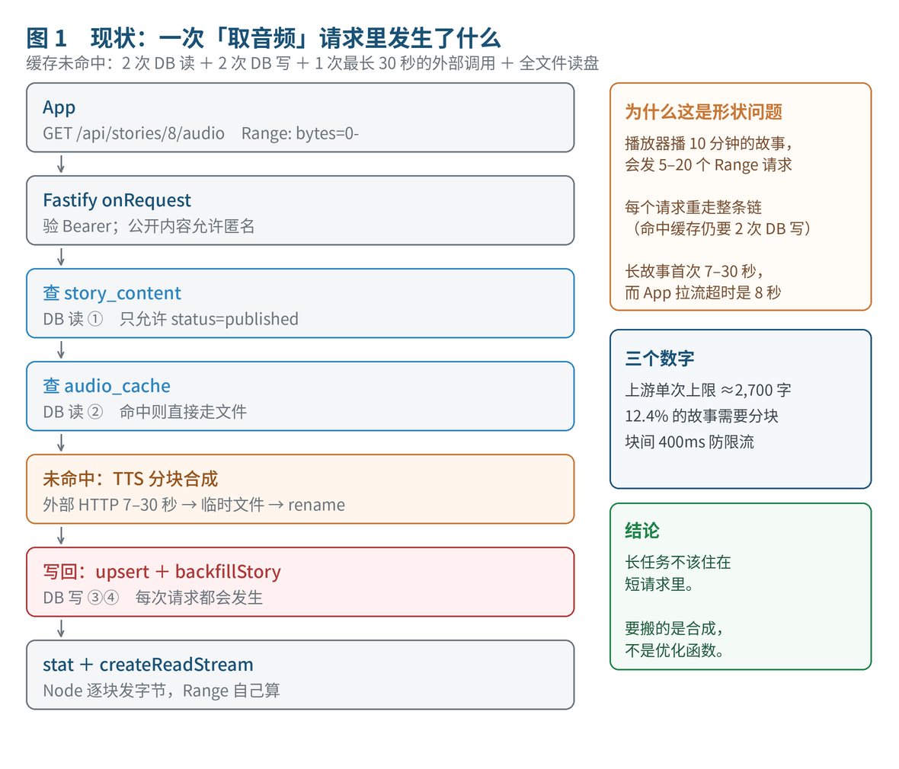
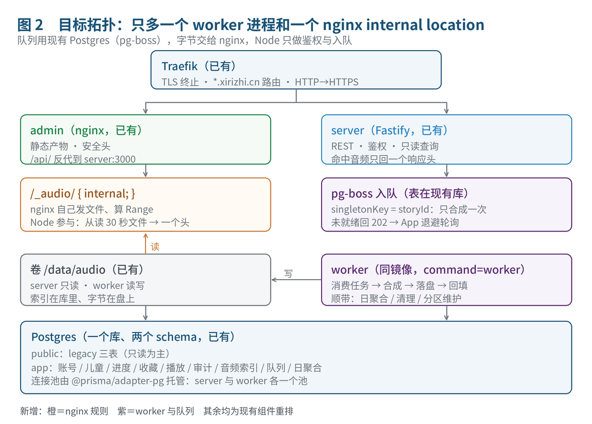

# 小故事铺（story）架构与技术方案优化 v2：把「三个分离」做出来

> 研究时间：2026-11-15　|　研究对象：guicaiyue/story（HEAD 在 2026-11-14 恢复 `apps/app` 之后）　|　方法：横纵分析法 —— 先看架构形状是怎么被历史逼成现在这样的（纵向），再把它放进 2026-11-15 的开源生态里逐层对照（横向），最后给出「变什么、不变什么、凭什么」的方案。开源项目的活跃度与版本取自当天 GitHub API 实测，不是记忆。

---

## 〇、结论地图

上一份报告回答的是「哪里疼」；这一份只回答一件事：**架构和技术的形状该怎么动，以及哪些地方我想清楚了不该动。**

一句话结论：**这个项目的架构问题不在"用了什么"，在"所有事都发生在同一个进程的同一条请求里"。** 于是目标不是换技术栈，而是把三件事从请求路径上剥出去 —— 重活（TTS 合成）、字节（音频传输）、发布（镜像与迁移）。我把它叫作**三个分离**。

| # | 现状的隐含假设 | 什么时候会破 | 目标形状 | 关键开源项目 |
| --- | --- | --- | --- | --- |
| 1 | 「合成音频」可以放在 HTTP 请求里同步做完 | 故事超过约 2,700 字，或并发 2 个以上 | server 入队 → **worker 消费** → 202 + 轮询 | [pg-boss](https://github.com/timgit/pg-boss)（4.1k★，v12.38.2 / 2026-11-10） |
| 2 | 「发音频字节」这件事该由 Node 做 | 播放器一次播放发 5–20 个 Range 请求 | **nginx internal + X-Accel-Redirect**，Node 只发一个头 | nginx（已装，零新增） |
| 3 | 「上线」等于在一台机器上敲五个命令 | 要回滚，或第二个人要上线 | **不可变镜像**（GHCR + revision label）+ 迁移独立 job | [Dokploy](https://github.com/Dokploy/dokploy)（38.5k★，v0.31.2 / 2026-11-13）可选 |
| 4 | 前后端各有一份「接口长什么样」 | 服务端改一个字段，前端静默漂移 | **zod 共享包**（`packages/contract`）+ OpenAPI 导出 | [openapi-typescript](https://github.com/openapi-ts/openapi-typescript)（8.4k★）/[orval](https://github.com/orval-labs/orval)（6.6k★） |
| 5 | 播放事件表可以无限长 | 半年后看板变慢，删除时锁表 | **按月分区 + 保留策略** | [pg_partman](https://github.com/pgpartman/pg_partman)（2.9k★，v5.5.0） |
| 6 | 标题搜索可以 `ILIKE '%q%'` 全表扫 | 内容超过 2 万条 | **pg_trgm GIN 索引**（零代码改动） | PostgreSQL contrib，无需新项目 |
| 7 | 「出事会有人知道」靠人想起来跑 status | 探针指向的容器已经不存在了 | **探针 + 告警 + 死信开关** | [Uptime Kuma](https://github.com/louislam/uptime-kuma)（94.1k★）/[healthchecks](https://github.com/healthchecks/healthchecks)（10.5k★） |
| 8 | 备份 = 一份同机 `pg_dump` | 需要「回到昨天 14:00」而不是「回到昨天」 | **WAL 归档 + PITR + 异地副本** | [pgBackRest](https://github.com/pgbackrest/pgbackrest)（4.5k★）+ [restic](https://github.com/restic/restic)（37.2k★） |

**没变的部分（每条都有理由，见 §4）**：Fastify 5、Prisma 7、pnpm workspaces、Traefik、Postgres 单库、Flutter + provider、antd 5→6、自研运营后台、自研迁移账本（短期保留）。

**判断：不需要引入的新东西** —— Redis、K8s、MinIO、消息中间件、tRPC、Turborepo、SigNoz/Loki 全家桶、refine。理由逐条写在 §4 与 §6.4。

---

## 一、纵向：架构形状被历史改了四次

要看懂「为什么是现在这个形状」，得先看它是怎么被一步步逼出来的。这个项目的架构不是设计出来的，是**被约束挤出来的**。

**第一形态（2025-04 → 2026-09）：纯前端 + 托管数据。** 一个 `index.html` 加 `app.js`，数据从公开 API 换到 supabase 客户端直连，再换到 pREST。这个阶段的架构特征是「**浏览器即应用，数据库即 API**」：没有服务端，所有逻辑在浏览器里，所有权限在数据库里。`add.html` 时期甚至让网页直接写库。

它的技术合理性在当时成立：一个人、一个静态站、零运维成本。它的失败方式也很典型：当一个前端开始需要「谁在看、看到哪、看了多久」这些**关系**时，客户端直连数据库就没有地方放业务规则了。pREST 那次实测把这个洞摊开了 —— 写方法能穿透 WAF 到 Postgres，还以超级用户身份执行。

**第二形态（2026-11-09 → 11-12）：单体 Fastify + 共库直读。** 决策 D1/D3 定的路子是「不迁移数据、Prisma 直读 legacy 三表、新表进独立 `app` schema」。这个决定把架构锁成了一个**贴着数据库长的服务端**：没有 repository 层（service 直接拿 PrismaClient）、没有 DTO 层（zod schema 就是契约）、没有事件总线。

四天出三端，靠的正是这种「不抽象」：每一层都可以省掉，因为只有一个人在写。

**第三形态（2026-11-13）：加了一层边缘。** Traefik 接管 TLS 与域名，server/admin 两个容器各自 healthy，音频挂在 Fastify 里流式发。这一层是必要的，也是唯一「多出来」的基础设施。

**第四形态（2026-11-14）：删掉一整个版本。** D9 删掉 1.0 之后，仓库从「双栈并行」变成「三端单栈」：`apps/server`、`apps/admin`、`apps/app`。

四次形态变化，有一条隐藏的规律：**每次都是"减少一层"而不是"增加一层"** —— 删掉 supabase、删掉 pREST、删掉 1.0、删掉中间抽象。这让项目在极小规模下跑得飞快，也意味着**它从来没有为"多个进程"设计过**。而现在唯一真正卡住它的，恰恰就是这一点：TTS 合成被塞进了请求里。

### 1.0 一次「取音频」到底发生了什么（这是全篇最重要的一张图）

<p align="center"></p>

一个"读"接口，在缓存未命中时做了 **3 次数据库写 + 1 次外部 HTTP（可能 30 秒）+ 1 次全文件读盘**；命中缓存时也还有 2 次写。而播放器播一首 10 分钟的故事，会发 5–20 个 Range 请求 —— 每一个都重新走一遍上面这条链。

**这就是"形状问题"最具体的样子**：不是某个函数写得不好，是一个长任务住在了一条短请求里。

---

## 二、横向：同类系统与 2026-11 的开源生态

我按「一个部署在单台 NAS 上、单库、面向家庭的小型内容服务」这个真实约束去比，而不是拿大厂架构当标杆。

### 2.1 同类系统的形状（三种活法）

| 参照物 | 它们的形状 | 对本案的意义 |
| --- | --- | --- |
| **Audiobookshelf**（自托管有声书，~10k★ 量级） | Node 单体 + SQLite/Postgres + **文件系统为主存储**，封面/音频都是静态文件，由 node 直接 serve，扫描器是后台 job | 和本项目最像。它把「扫描/转码/元数据」全部放后台 job，请求路径只做查询与文件流 —— 正是本项目该走的方向 |
| **Navidrome / Airsonic**（音乐流服务） | 单进程 + 索引库 + **流式 Range 由进程内发**，靠 `sendfile`/`io.Copy` 压低开销 | 说明「进程内发字节」在小规模下可行，但前提是**没有重活在同一条路径上** |
| **Calibre-Web / Komga** | Python/Java 单体 + 静态文件 + 反代 | 说明「应用 + 反代分工」是这类系统的默认形态 |

三条可比的经验，都不涉及大规模：**① 重活异步化；② 字节交给最擅长的层；③ 索引（元数据）与内容（文件）分开存。**

### 2.2 生态对照：能用的开源项目都是什么状态（2026-11-15 实测）

| 用途 | 项目 | ★ | 最近提交 | 最新版本 | 判断 |
| --- | --- | --- | --- | --- | --- |
| 任务队列（Postgres 内） | [pg-boss](https://github.com/timgit/pg-boss) | 4,141 | 2026-11-13 | v12.38.2（11-10） | **选它**：无需 Redis，事务内入队 |
| 任务队列（Postgres 内） | [graphile/worker](https://github.com/graphile/worker) | 2,444 | 2026-11-05 | — | 备选，偏 GraphQL 生态 |
| 任务队列（Redis） | BullMQ | 大 | 活跃 | — | **不选**：为它多跑一个 Redis 不值 |
| 迁移 | [dbmate](https://github.com/amacneil/dbmate) | 7,546 | 2026-11-14 | v2.38.1（11-09） | 轻量、带 down、事务化 |
| 迁移 | [Atlas](https://github.com/ariga/atlas) | 8,822 | 2026-11-05 | v1.3.0（08-02） | 声明式，功能强但概念多 |
| 分区 | [pg_partman](https://github.com/pgpartman/pg_partman) | 2,853 | 2026-11-05 | v5.5.0（07-22） | **选它**：扩展，SQL 层解决 |
| 认证 | [better-auth](https://github.com/better-auth/better-auth) | 30,747 | 2026-11-14 | v1.7.24（11-14） | 有 phoneNumber OTP + 内置限流 |
| 契约 | [openapi-typescript](https://github.com/openapi-ts/openapi-typescript) | 8,438 | 2026-09-25 | — | 类型生成，零运行时 |
| 契约 | [orval](https://github.com/orval-labs/orval) | 6,614 | 2026-11-14 | — | 连 client+hooks 一起生成 |
| 契约 | [fastify-type-provider-zod](https://github.com/turkerdev/fastify-type-provider-zod) | 592 | 2026-11-08 | — | 小而准，配 Fastify schema |
| 前端数据 | [TanStack Query](https://github.com/TanStack/query) | 50,564 | 2026-11-14 | — | **选它** |
| 后台框架 | [refine](https://github.com/refinedev/refine) | 36,042 | 2026-09-10 | — | 现在不用，阈值见 §4 |
| 后台框架 | [react-admin](https://github.com/marmelab/react-admin) | 26,992 | 2026-11-14 | — | 同上 |
| PaaS | [Dokploy](https://github.com/Dokploy/dokploy) | 38,505 | 2026-11-13 | v0.31.2（11-13） | 第二阶段可选 |
| PaaS | [Coolify](https://github.com/coollabsio/coolify) | 66,071 | 2026-11-14 | — | 更重，Swarm/K8s 路线 |
| 部署 | [kamal](https://github.com/basecamp/kamal) | 14,727 | 2026-11-14 | — | 无 UI，靠 YAML |
| 多机编排 | [komodo](https://github.com/moghtech/komodo) | 12,935 | 2026-10-23 | — | 多机才需要 |
| 探针 | [Uptime Kuma](https://github.com/louislam/uptime-kuma) | 94,138 | 2026-11-14 | — | **选它** |
| 探针 | [Gatus](https://github.com/TwiN/gatus) | 12,775 | 2026-11-12 | — | 声明式，适合进 git |
| 定时任务死信 | [healthchecks](https://github.com/healthchecks/healthchecks) | 10,516 | 2026-11-13 | — | **选它**（管 timer） |
| 日志 | [Dozzle](https://github.com/amir20/dozzle) | 14,930 | 2026-11-14 | — | **选它**（先于 Loki） |
| 日志聚合 | [Loki](https://github.com/grafana/loki) + [Alloy](https://github.com/grafana/alloy) | 29,160 / 3,692 | 活跃 | — | 现在过重 |
| 可观测全家桶 | [SigNoz](https://github.com/SigNoz/signoz) | 32,640 | 2026-11-14 | — | 现在过重 |
| 备份 | [pgBackRest](https://github.com/pgbackrest/pgbackrest) | 4,499 | 2026-11-13 | — | **选它**（PITR） |
| 备份 | [restic](https://github.com/restic/restic) | 37,223 | 2026-11-06 | — | **选它**（异地/文件） |
| 对象存储 | MinIO | 61,254 | **已归档 2026-04-24** | — | **不选**（项目已停更） |
| 对象存储 | [SeaweedFS](https://github.com/seaweedfs/seaweedfs) / [RustFS](https://github.com/rustfs/rustfs) | 36,067 / 36,091 | 2026-11-14 | — | 需要 S3 才考虑 |
| TTS | [CosyVoice](https://github.com/QwenAudio/CosyVoice) | 24,401 | 2026-05-25 | — | 自托管首选（Apache-2.0） |
| TTS | [Kokoro](https://github.com/hexgrad/kokoro) | 10,117 | 2025-08-06 | — | 更新慢 |
| TTS | [piper1-gpl](https://github.com/OHF-Voice/piper1-gpl) | 6,285 | 2026-11-13 | — | 原 piper 已归档，转这个 |
| 压测 | [k6](https://github.com/grafana/k6) | 32,296 | 2026-11-14 | — | 验音频接口 p95 |
| 密钥扫描 | [gitleaks](https://github.com/gitleaks/gitleaks) | 31,026 | 2026-10-28 | — | CI 加一条 |
| 镜像扫描 | [trivy](https://github.com/aquasecurity/trivy) | 39,340 | 2026-11-14 | — | 可选 |
| 依赖更新 | [renovate](https://github.com/renovatebot/renovate) | 23,118 | 2026-11-14 | — | **选它** |

这张表里有两个「坑」值得单独标出来，因为它们是 2026 年才发生的：

- **MinIO 已在 2026-04-24 归档**。任何「音频上对象存储」的方案如果照着老文章选 MinIO，会踩到一个停更项目。真要对象存储，看 SeaweedFS 或 RustFS。
- **piper 已归档**（2025-08），现在维护的是 `piper1-gpl`。上一份报告里我提「Piper 做离线降级」，这里更正指向。

### 2.3 一个反直觉的横向结论

把所有候选按「引入成本 / 解决的痛点」排序后，**最划算的三个项目都不是新服务，而是三个"就地替换"**：

1. `pg-boss` —— 复用已有 Postgres，多跑一个进程（同镜像），解决 TTS 超时；
2. nginx `X-Accel-Redirect` —— 现成的 nginx，加一个 `internal` location，解决字节传输；
3. `Uptime Kuma` + `healthchecks` —— 两个容器，解决「出事没人知道」。

反过来，最不划算的是「换框架」「换 ORM」「上 PaaS 全家桶」「上 Loki/SigNoz」——它们解决的是规模问题，而这个项目的规模问题是 2,197 条故事。

---

## 三、横纵交汇：目标架构（三个分离）

### 3.1 为什么是「三个分离」，而不是「微服务化」

纵向看，这个项目四次形态变化都在做减法：删 supabase、删 pREST、删 1.0、删中间层。它的核心竞争力是「一个人能看懂全部代码」。所以任何方案只要引入「多一个需要单独理解的系统」，就是在跟这条主线对抗。

横向看，2,197 条故事、单台 NAS、家庭用户，峰值并发大概率是两位数的 QPS。K8s、消息队列集群、服务网格在这个规模下全是负资产。

于是「三个分离」的定义是：**在不新增"需要单独运维的组件"的前提下，把三件不该挤在一起的事拆开。**

| 分离 | 拆什么 | 用什么 | 新增运维面 |
| --- | --- | --- | --- |
| ① 请求与重活 | TTS 合成从 HTTP 请求里搬到 worker | `pg-boss`（表就在现有库里）+ 同镜像第二 command | **零**（无新中间件，只有多一个容器） |
| ② 内容与呈现 | 音频字节从 Node 流搬到 nginx | `X-Accel-Redirect` + `internal` location | **零**（nginx 已在） |
| ③ 发布与代码 | 「上线」从 shell 历史搬进镜像 | GHCR + 不可变 tag + revision label + 迁移独立 job | **零**（只是换了 tag 来源） |

一句话：**三个分离全部"零新增运维面"，这是它们能落地的唯一理由。**

### 3.2 目标拓扑

<p align="center"></p>

与现状相比，图里只多了两个东西：**worker 进程** 和 **nginx 的 internal location**。其余全是重排：Traefik、admin、server、命名卷、Postgres 都原样不动。

### 3.3 取音频的一次请求（目标状态）

- **就绪判定**：`POST /api/stories/:id/audio/prepare` → `{ status: 'ready' | 'pending', etaSec? }`
- **取字节**：`GET /api/stories/:id/audio`（带 `Range`）→ 200/206，实际由 nginx 发出

具体两条路：

- **已就绪**：Fastify 只做一次鉴权 + 一次索引查询（`audioCache.status='ready'`），然后回 `X-Accel-Redirect: /_audio/stories/0/8.mp3`，nginx 按 `internal` 规则自己发文件、自己算 Range、自己加 `Cache-Control`。**Node 参与的工作量从「读 30 秒文件」降到「发一个头」。**
- **未就绪**：Fastify 用事务往 `pg-boss` 的队列塞一个 `tts.synthesize` 任务，回 `202 { status: 'pending' }`。App 端轮询（1s、2s、4s 退避，最多 30s），或直接重试 `GET`（未就绪时回 `425 Too Early` 或 `202`）。

同一个故事被多个请求同时触发时，`pg-boss` 的唯一键（`singletonKey: storyId`）+ 数据库唯一约束保证**只合成一次**。这就顺手解决了现在没有 single-flight 的问题。

---

## 四、技术方案逐层决策（含"保持不变"的理由）

这一节按层过一遍。每一行都要回答「为什么变」或「为什么不干脆变」。

### 4.1 运行时要什么

| 项 | 现在 | 建议 | 理由 |
| --- | --- | --- | --- |
| 语言运行时 | Node 22 | **保持 22** | Prisma 7 要求 `^20.19 ‖ ^22.12 ‖ >=24`；Node 24 在 NAS 上没必要冒险。CI 与 Dockerfile 版本对齐到 22 即可 |
| Web 框架 | Fastify 5.12.8 | **保持** | 就是最新稳定线（[官方基准 2026-11-01](https://fastify.dev/benchmarks/)：89,733 req/s，Hono 84,930、Express 67,794）。换框架的唯一收益是新鲜感，成本是 6 个路由文件 + 全部测试 |
| 进程模型 | 单进程 | **改：server + worker 双 command、同镜像** | 这是本次唯一"结构性"改动。同镜像保证版本永远一致，没有「worker 跑了旧代码」这种事 |
| 反向代理 | Traefik + 容器内 nginx | **保持** | 已跑通 TLS 与双域名；`X-Accel-Redirect` 走 admin 容器里的 nginx 就够，不需要引入 Caddy |
| 包管理/工作区 | pnpm 11 workspaces | **保持** | 2 个 app，Turborepo（2.11.11）能省的构建时间在这个规模下小于它带来的配置与心智成本 |

### 4.2 数据层

| 项 | 现在 | 建议 | 理由 |
| --- | --- | --- | --- |
| ORM | Prisma 6.19.3 | **升 7.10.1** | Rust-free client 包体小约 90%、查询最多 3x（厂商口径）；对你更实际的是**必须显式传驱动适配器**，于是连接池终于能被控制（现在 `createPrisma()` 完全没配，见 `db.ts:8-13`） |
| 是否换 Drizzle | — | **不换** | 你最大的约束是「映射一个不能改的 legacy 结构」（`@@map`/`@@schema`/multiSchema），这正是 Prisma 的强项；换 ORM 等于把 D1/D3 的成果重做一遍。Drizzle 的优势（SQL 即 TS）在你这里用不上 |
| 连接池 | 无 | **`@prisma/adapter-pg` + 显式 `max`** | 单实例 + worker 后连接数会翻倍，必须显式配。多实例再上 PgBouncer（4.4k★，2026-11 活跃） |
| 迁移执行器 | 自研 `migrate.mjs`（逐语句、剥事务、无 down） | **短期加护栏；中期换 dbmate** | 见 §5 第 5 条。只想要事务的话 5 行改动；想要 down 迁移才需要换工具 |
| `play_event` 容量 | 单表 + `[at]` 索引 | **pg_partman 按月分区 + 12 个月保留** | 这是唯一会无限增长的表；分区后删除只需 `DROP PARTITION`，不再 `DELETE` 大事务 |
| 标题搜索 | `contains insensitive` 全表扫 | **`pg_trgm` GIN 索引** | 零代码改动：建扩展 + 建索引，`ILIKE '%x%'` 自动走索引。2 万条以内够用，不需要 Meilisearch |
| 审计 | 9 处手写 `audit_log.create`，故事 PATCH 一处没写 | **Prisma Client Extension 统一拦截** | 用 `$extends({ query: { story: { update(...) } } })` 在数据层记 before/after，比在 12 个路由里记得写更可靠 |
| 分区外的读性能 | 看板每次全表聚合 | **日聚合表 `app.daily_metrics`**（worker 里定时算） | 看板读聚合表，毫秒级；顺便让「历史数据归档后看板仍可用」 |

**为什么不用时序库（TimescaleDB）**：它对 `play_event` 确实合适，但会把「一个库」变成「一个需要单独装扩展的库」，而 NAS 上的 Postgres 是共享的。pg_partman 是同一个目标的最小代价。

### 4.3 接口与契约

| 项 | 现在 | 建议 | 理由 |
| --- | --- | --- | --- |
| 校验 | 每个 handler 手写 `Xxx.parse()` | **Fastify `schema` + fastify-type-provider-zod** | 校验进框架层、`request.body` 自动带类型；顺手让 `@fastify/swagger` 生成 OpenAPI |
| 前后端类型 | 前端手写 100 行镜像（`client.ts:113-214`） | **`packages/contract`（zod 4）** | 「契约先行」在架构文档第 3 行，落地断在这里；共享包让漂移变成编译错误 |
| OpenAPI | 无 | **生成 spec + openapi-typescript** | 给后台生成类型；也是"接口清单"这个文档的自动化来源 |
| Flutter 端模型 | 手写 + `test_live` 联调测试 | **保持手写** | 生成器（openapi-generator 的 Dart 支持）维护成本高于收益；现有 5 个 `test_live` 用例已经在守字段名。**这是一个明确的"不变"决定** |
| zod 版本 | 3.25.76（命中 `GHSA-mrhx-c7xc-m3w5`，修复版 4.6.6） | **升 4.6.7** | 安全通告是硬理由；顺带统一前后端 |

### 4.4 认证与授权

| 项 | 现在 | 建议 | 理由 |
| --- | --- | --- | --- |
| 凭证形态 | `@fastify/jwt` 9.1.0，**无 expiresIn** | **短期：加 `exp` + 刷新** | 不换库。`sign: { expiresIn: '2h' }` + 一个 `/api/auth/refresh`；后台 token 从 localStorage 迁 httpOnly cookie（`/api` 已经同源反代，天然支持） |
| 是否换 better-auth | — | **中期评估，不现在换** | 它确实有 phoneNumber OTP（`sendOTP` 回调正好接你的 `SmsAdapter`）与内置限流，30.7k★、v1.7.24。但换它要动 4 张表 + 全部登录路由 + Flutter 端。**触发条件：接真实短信通道那天**（因为 OTP 表、重发限制、尝试次数这些正是它的强项） |
| 授权 | `requireRole` 手写 + 每次回库 | **保持手写，但抽成 policy 模块** | 现在只有 3 个角色、12 个动作。抽成 `policy.ts`（`can(role, action, resource)`）比引 CASL（7.1k★）/ZenStack（2.9k★）更小、更好测。**前端**用 role 条件渲染即可，不为 12 个权限项引框架 |
| 限流 | 无 | **`@fastify/rate-limit` 11.2.2** | 登录/发码/游客注册三处必须单独限；这是 P0-1 的一半答案 |
| 游客账号治理 | 每次调用建一个 | **加「同设备复用」+ 定时清理** | 现状无限增长；worker 里跑一个每日任务清理 30 天无行为的游客 |

**为什么不直接上 Keycloak/Zitadel**：那是给"多应用、多租户、要 SSO"的场景。你只有两个客户端和一打角色，装了它等于把认证从 200 行代码变成一个需要单独升级的服务。

### 4.5 前端

| 项 | 现在 | 建议 | 理由 |
| --- | --- | --- | --- |
| 数据层 | 自研 `useAsync`（无缓存/无失效/401 不联动） | **TanStack Query 5** | 50.6k★，一周能吃完；`queryKey` + `staleTime` 顺手解决「每次导航重复拉 dashboard」 |
| 组件库 | antd 5.29.3 | **升 6.7.0** | 现状稳定线；先改测试里的中文按钮断言（`'创 建'` 这类），再升 |
| 构建 | Vite 5.4.21 | **分两步升 6→7→8** | 5.4.21 挂 8 条 OSV 通告，但全部是 dev server / Windows 相关，**不进生产产物**。所以"该升但不是安全问题"，优先级排在测试与契约之后 |
| 后台脚手架 | 自研 9 页 | **保持自研** | refine（36k★）/react-admin（27k★）的收益曲线是「页面数 × CRUD 复杂度」。现在 9 页、4 个自定义看板页，重写成 resource 模型的成本大于收益。**触发条件：新增第 15 个列表页，或需要通用筛选/导出** |
| 路由 | react-router 6 | **保持 6** | 升 7 只是为了 `react-router` 单体包；TanStack Router 在这个规模 ROI 为负 |
| 错误处理 | 无 ErrorBoundary | **加**（`react-error-boundary`，或手写 30 行） | 承诺过"失败不白屏"，`ui.tsx:50-52` 自己写着，但没兜住渲染异常 |

### 4.6 移动端

| 项 | 现在 | 建议 | 理由 |
| --- | --- | --- | --- |
| 状态管理 | `provider` + `ChangeNotifier` | **保持** | 9 屏、一个 `AppState`。Riverpod/Bloc 会多一层抽象，而 App 端真正的痛点是「登录与音频」，不是状态管理 |
| 音频 | `just_audio` + `PlayerService` 抽象 | **保持抽象，改实现** | worker 化后要处理 202 → 轮询 → 播放；`PlayerService` 正好是唯一的改动点（`lib/services/player_service.dart`） |
| 模型 | 手写 + `test_live` | **保持** | 见 §4.3 |
| 必改项 | 无 | **`registerDevice()` 接入启动流程** | 现在启动不注册，真机上「继续听/收藏」必 401。这是产品闭环缺口，不是技术选择 |

### 4.7 交付与运维

| 项 | 现在 | 建议 | 理由 |
| --- | --- | --- | --- |
| 镜像 tag | `story-server:m4`（可变） | **`ghcr.io/…/story-server:v0.1.3-<sha>` + revision label** | 可回滚 = 改 `.env.prod` 里的变量再 `up -d` |
| 镜像来源 | 本地构建 | **GHCR 推拉** | 顺带解决了「CI 绿但镜像崩」 |
| 部署执行 | 手写 `prod-deploy.sh` | **保持脚本，补 `up --wait` + 迁移独立 job** | 现阶段不需要平台。Dokploy（38.5k★，v0.31.2）在「有第二个人要上线」或「要 UI 回滚」时再上，代价是一个需要备份自身数据库的控制面 |
| 探针 | 自研 `poll-prod.sh`（指向已退役容器） | **Uptime Kuma**（HTTP + 关键字校验）+ 保留事件派发 | 94.1k★，容器一个，带通知与状态页；比手写脚本可靠 |
| 定时任务死信 | 无 | **healthchecks** | `story-preflight.timer`、备份、日聚合三个 job 各 ping 一个 URL，**没 ping 就报警** —— 这才是「探针自己死了」的解法 |
| 日志 | json-file 无上限 | **Dozzle + `logging.max-size`** | 14.9k★，实时看容器日志，零配置；Loki/Alloy 等你真的需要检索 7 天以上再说 |
| 错误追踪 | pino 到 stdout | **先 Dozzle 检索，后 Sentry** | 自托管 Sentry（getsentry/self-hosted）一套要 4–6 个容器；现在没有真实用户量，不值 |
| 备份 | 同机 `pg_dump` | **pgBackRest（PITR）+ restic（异地）+ healthchecks 守时** | 现在的恢复粒度是「整库」，而真实需求是「回到某个点」；PITR 才能做到 |
| 依赖更新 | 无 | **renovate** | 23.1k★，一条配置文件；否则「版本落后 3 个大版本」会一直复发 |
| 密钥泄露 | 无扫描 | **gitleaks** 进 CI | `.env.prod` 只在本地，但历史里出现过凭据；一条 job 保平安 |

---

## 五、痛点 → 开源项目：可执行映射（这是本次的核心交付）

每条都写清：痛点（带证据）→ 选哪个项目 → 怎么接 → 成本 → 风险 → 怎么验收。**排序按「痛度 ÷ 成本」。**

### ① 镜像不可变 → 有回滚
- **痛点**：`docker-compose.prod.yml:31,104` 写死 `:m4`，`prod-deploy.sh:70-77` 每次覆盖 → 旧镜像退化成 `<none>`。
- **方案**：CI 构建带 `--label org.opencontainers.image.revision=${GITHUB_SHA}` 的镜像推 GHCR；compose 改 `${STORY_SERVER_IMAGE}`。
- **成本**：半天。**风险**：NAS 能否 pull GHCR 未验证（先用一个测试 tag 试）。
- **验收**：`docker inspect story-server-prod --format '{{index .Config.Labels "org.opencontainers.image.revision"}}'` 等于 `git rev-parse HEAD`；回滚演练 < 2 分钟。

### ② TTS 同步合成 → pg-boss worker
- **痛点**：p90 7–30 秒挡在请求里；App 8 秒超时 → 长故事首次播放降级；并发两个请求 = 两次完整合成。
- **方案**：worker 容器跑 `pg-boss`（v12.38.2），`singletonKey: storyId` 去重；`audioCache` 加 `status(pending|ready|failed)`；接口回 `202`。
- **成本**：2 人日（含 App 轮询）。**风险**：worker 与 server 共用一个卷，注意权限与磁盘配额。
- **验收**：k6 对同一 story 并发 20 次 `prepare`，DB 里 `tts` 任务只有 1 条；p95 响应 < 200ms。

### ③ 音频 Range 写放大 → nginx X-Accel-Redirect
- **痛点**：每个 Range 请求都走 `getOrCreateAudio`，命中缓存也写 2 次库（`tts-service.ts:129-134`）。
- **方案**：Fastify 只查索引，命中就回 `X-Accel-Redirect: /_audio/...`；nginx 加 `location /_audio/ { internal; alias /data/audio/; }`。
- **成本**：半天。**风险**：`alias` 与 `internal` 组合要实测 Range（206 与 `Content-Range`）。
- **验收**：一次播放 15 个 Range 请求，`pg_stat_statements` 里对 `audio_cache` 的 UPDATE 从 15 次降到 0。

### ④ 播放事件无限增长 → pg_partman
- **痛点**：`play_event` 只有 `[at]` 索引，看板 `GROUP BY story_id` 全表扫（`admin-service.ts:127-138`）。
- **方案**：按月 `RANGE` 分区（`at`）+ `pg_partman` 自动建/删分区 + 日聚合表。
- **成本**：1 人日（Prisma 不管分区，要写原生 SQL 迁移）。**风险**：分区表上 Prisma 的 `create` 正常，但要确认 `@@map` 与主键包含分区键。
- **验收**：`EXPLAIN` 显示 partition pruning；`DELETE` 旧数据变成 `DROP PARTITION`（毫秒级）。

### ⑤ 迁移半死 → 事务 + 护栏（短期）/ dbmate（中期）
- **痛点**：`migrate.mjs:184-207` 逐语句执行，`split-sql.mjs:40` 剥掉 `BEGIN/COMMIT`，无 down，接受任何 `DATABASE_URL`。
- **方案**：短期把每个迁移文件包进一个事务、启动时校验库名白名单（`story` 需显式 `--allow-prod`）；中期换 `dbmate`（7.5k★，v2.38.1，自带 up/down/事务/迁移表）或 Atlas（8.8k★，声明式）。
- **成本**：护栏 2 小时；换 dbmate 约 1 人日 + 一次账本对账。**风险**：老库 P3005 的历史问题要保留（这就是自研 runner 存在的原因），换工具时不要把这个坑重踩。
- **验收**：故意让第 3 句 SQL 报错 → 表结构与账本都回到执行前。

### ⑥ 契约漂移 → packages/contract + OpenAPI
- **痛点**：`client.ts:113-214` 手写类型；`pnpm-workspace.yaml:4` 声明了不存在的 `packages/*`。
- **方案**：新建 `packages/contract`（zod 4 schema + `z.infer`）；服务端挂 Fastify schema；`@fastify/swagger` 出 spec，`openapi-typescript` 生成前台类型（或 orval 连 hooks 一起生成）。
- **成本**：1 人日。**风险**：zod 3→4 有破坏性改动（`z.string().email()` 等 API 变化），要一起改。
- **验收**：故意把服务端某个字段改名 → 前台 `tsc` 报错（而不是运行时静默 `undefined`）。

### ⑦ 审计断在故事 PATCH → Prisma Extension
- **痛点**：9 处 `auditLog.create`，故事 PATCH（`admin-routes.ts:141-162`）与分类改名（`:236-243`）一个字不记；前端却预置了 `category.update` 标签。
- **方案**：`$extends({ query: { $allModels: { $allOperations } } })` 在数据层记 `{model, action, before, after, actorId}`；`actorId` 通过 AsyncLocalStorage 从请求上下文传。
- **成本**：半天。**风险**：全量拦截会带来写放大，只对白名单模型开启。
- **验收**：改一条故事的 `age_band`，`audit_log` 里出现 before/after 与操作人。

### ⑧ editor 能绕过审核 → 服务端收口
- **痛点**：`admin-routes.ts:26` 的 `status` 可选 + `:142` 的 `anyRole` → editor 绕过 `:209` 的 `adminOnly` 审核闸。
- **方案**：`status` 从 `StoryPatch` 里拆出，命中 `published` 时要求 `admin`；前端按 role 隐藏按钮。
- **成本**：1 小时。**风险**：现有运营流程若依赖 editor 直接上架，要同步改流程。
- **验收**：用 editor token 调 PATCH `status=published` → 403；review 接口仍是 200。

### ⑨ 凭证永不过期 / 无限流 → exp + @fastify/rate-limit
- **痛点**：三处 `sign` 无 `expiresIn`；无 `@fastify/rate-limit`；游客注册可无限建号。
- **方案**：`expiresIn: '2h'` + refresh；`@fastify/rate-limit` 全局 100/min，登录 5/5min，发码 3/10min，游客注册 10/hour。
- **成本**：半天。**风险**：refresh 流程要改 Flutter 端（`api_client.dart`），否则用户每天要重登。
- **验收**：`jwt.decode` 有 `exp`；连打 6 次登录 → 第 6 次 429。

### ⑩ 出事没人知道 → Uptime Kuma + healthchecks
- **痛点**：`poll-prod.sh:24` 默认 `CONTAINER=story`（已退役），版本漂移永远不告警；告警只有中台一个出口。
- **方案**：Uptime Kuma 监控 `api-story`/`admin-story` 两个 URL + 关键字；`/api/ready`（写路径探针）单独一条；`story-preflight.timer`、备份任务各 ping healthchecks。
- **成本**：2 小时。**风险**：又一个单点（放在 NAS 上），但比"没有"强得多。
- **验收**：停掉 server 容器 → 90 秒内收到通知。

### ⑪ 日志吃盘 / 事后查不到 → Dozzle + 上限
- **痛点**：compose 无 `logging:`，json-file 无上限。
- **方案**：`max-size: 10m / max-file: 3` + Dozzle 挂载 docker.sock（只读）。
- **成本**：1 小时。**风险**：Dozzle 要看 socket，需限制到内网/加 basic auth。
- **验收**：`docker inspect` 显示 log opts；Dozzle 里能搜到 `level":50`。

### ⑫ 备份只有「回到昨天」→ pgBackRest + restic
- **痛点**：`prod-deploy.sh:32,55-66` 同机 `pg_dump`，无保留策略、无异地、恢复粒度 = 整库。
- **方案**：pgBackRest 做全量/增量 + WAL 归档（PITR）；restic 把备份目录与音频缓存异地；healthchecks 守时；每季度一次自动恢复演练（恢复到 `story_restore_drill` 库，跑一遍 smoke 再删）。
- **成本**：1.5 人日。**风险**：pgBackRest 要改 `postgresql.conf`（`archive_mode=on`），对生产库是配置变更，需批准。
- **验收**：`pgbackrest --stanza=story --type=time "--target=2026-11-15 14:00:00" restore` 成功，且 smoke 通过。

### ⑬ CI 无库 → service container（已有方案，重申）
- **成本**：20 行 YAML。**验收**：PR 里服务端 136 个测试跑在 CI 上，红即阻断。

### ⑭ 依赖陈旧 / 密钥泄露 → renovate + gitleaks
- **成本**：各 1 小时。**验收**：renovate 第一周就会开出 5+ 个 PR；gitleaks 对历史全量扫描（含 `docs/product/13-*.sql` 里的示例凭据，需先加 allowlist）。

### ⑮ 出包靠人记 → 已经解决，别动
`apps/app/tool/build-release-apk.sh` 已经做到「签名/版号/基址」三重自检，`libapp.so` 里搜 `127.0.0.1:3000` 那一步尤其漂亮。**这是全项目最成熟的一段脚本，保持原样。**

---

## 六、分阶段落地（含"什么都不做"的选项）

### 阶段 0：本周（约 1.5 人日，不新增任何组件）

1. JWT 加 `exp`（2h）+ `@fastify/rate-limit` 三处收紧；
2. `status → published` 收口 admin-only；
3. 故事 PATCH 补审计（先手写，不等 Extension）；
4. 删 `apps/admin/Dockerfile:54` 那行空引用；
5. `preflight.sh` 的 `TARGET_DB`、`poll-prod.sh` 的 `CONTAINER` 改默认值。

**这五条不需要讨论架构，改完就能验证。** 如果只做这一档，项目会从「能跑」变成「能安全地跑」。

### 阶段 1：本月（约 5 人日，新增 1 个进程 + 1 个 nginx location）

6. 136 测试进 CI（service container）；
7. 不可变镜像 + GHCR + revision label + `up --wait`；
8. `packages/contract` + zod 4 + Fastify schema；
9. `pg-boss` worker + 音频 `X-Accel-Redirect`（③ 与 ② 一起做，因为都改音频路径）；
10. Prisma 7 + `@prisma/adapter-pg`。

**为什么 9 和 10 放一起**：都动 `db.ts` 与连接池，一次改完只测一轮。

### 阶段 2：本季度（需预算与批准）

11. pgBackRest PITR + restic 异地 + healthchecks（要改 `postgresql.conf`，必须走批准）；
12. pg_partman 分区 + 日聚合表；
13. Uptime Kuma + Dozzle + 日志上限；
14. `pg_trgm` 索引 + 游客账号清理 job；
15. antd 6 → Vite 8 分两步。

### 6.4 明确不做，以及为什么（这一节同样重要）

| 不做 | 理由（不是"不推荐"，是"在这个规模下负收益"） |
| --- | --- |
| 换 Hono/Nest | 基准无收益（89.7k vs 84.9k req/s），改造面 100% |
| Prisma 换 Drizzle/Kysely | 你的硬约束是映射不可改的 legacy 表，这正是 Prisma 的价值；迁移账本也要重做 |
| 引入 Redis / Kafka / RabbitMQ | `pg-boss` 已经用现有 Postgres 做到事务性队列；多一个中间件就多一个要备份、要监控、要升级的东西 |
| K8s / Nomad | 一台 NAS、两个服务；编排收益为零，学习与运维成本为正 |
| MinIO 对象存储 | **项目已归档（2026-04-24）**；而且你的音频是可再生派生物，本地卷 + nginx 足够。真要 S3 再看 SeaweedFS/RustFS |
| Loki + Alloy + SigNoz 全家桶 | 4–6 个容器换「日志检索」。Dozzle 先顶；等日志成为排查瓶颈再说 |
| 自托管 Sentry | 同上，一套 4–6 容器。先靠 `level:50` + Dozzle |
| refine / react-admin 重写后台 | 9 页、4 个自定义看板页，重写成 resource 模型成本 > 收益。触发条件写死在 §4.5 |
| tRPC | 已有 APK 在跑 REST；tRPC 会把公开 API 变成只有 TS 客户端能用的私有 API |
| Turborepo | 2 个 app，构建缓存省下的时间 < 配置成本 |
| Flutter 端代码生成 | 现有 `test_live` 已经在守字段名；生成器维护成本更高 |
| 把 `migrate.mjs` 立刻换成 Atlas | 声明式迁移适合"想从零重建 schema"的场景；你面对的是一个既有生产库，换工具的风险 > 收益。先加护栏 |

---

## 七、验收：怎么证明每一条真的生效

不做"测试通过"这种结论，只认命令级证据：

```bash
# ① 回滚能力：生产跑的是哪个 commit
docker inspect story-server-prod --format \
  '{{index .Config.Labels "org.opencontainers.image.revision"}}'
#   → 应等于 git rev-parse HEAD
#   把 .env.prod 的 STORY_SERVER_IMAGE 改回上一个 tag，up -d，计时

# ② TTS 去重：20 个并发 prepare 只应产生 1 条任务
seq 20 | xargs -P20 -I{} curl -s -o /dev/null -w '%{http_code}\n' \
  -X POST -H "Authorization: Bearer $T" \
  http://127.0.0.1:3000/api/stories/8/audio/prepare | sort | uniq -c
#   → 全 202；任务表里 storyId=8 只有 1 行

# ③ Range 不再写库
psql -c "select calls from pg_stat_statements \
          where query ilike '%audio_cache%'"
#   → 播放 15 个 Range 请求前后，calls 不变

# ④ 迁移原子性：故意改坏第 3 条语句
#   → 表结构与账本都要回到执行前

# ⑤ 契约漂移变成编译错误
#   服务端把 excerpt 改名 → admin typecheck 必须红

# ⑥ 审计完整性
psql -c "select action,target,detail from app.audit_log \
          order by at desc limit 5"
#   → 改一次 age_band 后能看到 before/after

# ⑦ 越权收口：editor 直接上架应 403
curl -s -o /dev/null -w '%{http_code}\n' -X PATCH \
  -H "Authorization: Bearer $EDITOR" -d '{"status":"published"}' \
  http://127.0.0.1:3000/api/admin/stories/8

# ⑧ 告警真的会响
docker stop story-server-prod && sleep 90 \
  && docker start story-server-prod
#   → Uptime Kuma 通知

# ⑨ 备份能回到某个点
pgbackrest --stanza=story --type=time \
  "--target=2026-11-15 14:00:00" --target-action=promote restore
```

---

## 八、信息来源

**代码与本仓库证据**（2026-11-14/15 读取，HEAD 含 `4ea04e0`、`c6fe151`）
- `apps/server/src/**`、`apps/server/scripts/{migrate,run-tests,split-sql}.mjs`、`prisma/schema.prisma`
- `apps/admin/src/api/client.ts`、`App.tsx`、`pages/*`、`nginx.conf`、`Dockerfile:54`
- `docker-compose.prod.yml`、`scripts/{preflight,prod-deploy}.sh`、`scripts/autoloop/poll-prod.sh`、`.github/workflows/ci.yml`
- `docs/product/{02-architecture,03-decisions,10-prod-migration-baseline,12-prod-deploy-runbook,24-prod-deploy-20261113}.md`、`docs/handover.md`、`AGENTS.md`
- `apps/app/**`（Flutter 0.1.2+3，`lib/services/player_service.dart`、`tool/build-release-apk.sh`）

**开源项目实测**（GitHub API，2026-11-15；stars / 最近 push / 最新 release 见 §2.2 表）
- pg-boss v12.38.2（2026-11-10）、dbmate v2.38.1（2026-11-09）、Atlas v1.3.0（2026-08-02）、pg_partman v5.5.0（2026-07-22）
- Dokploy v0.31.2（2026-11-13）、better-auth v1.7.24（2026-11-14）
- MinIO **archived 2026-04-24**；rhasspy/piper **archived**（现行 `OHF-Voice/piper1-gpl`）
- Uptime Kuma 94,138★ / Gatus 12,775★ / Dozzle 14,930★ / healthchecks 10,516★ / pgBackRest 4,499★ / restic 37,223★
- TanStack Query 50,564★ / refine 36,042★ / react-admin 26,992★ / openapi-typescript 8,438★ / orval 6,614★ / fastify-type-provider-zod 592★
- SeaweedFS 36,067★ / RustFS 36,091★ / CosyVoice 24,401★ / Kokoro 10,117★ / piper1-gpl 6,285★
- k6 32,296★ / gitleaks 31,026★ / trivy 39,340★ / renovate 23,118★ / SigNoz 32,640★ / Loki 29,160★

**官方文档与实测**
- [Fastify Benchmarks](https://fastify.dev/benchmarks/)（2026-11-01）：Fastify 89,733 req/s / Hono 84,930 / Express 67,794
- [Prisma ORM v7 升级指南](https://www.prisma.io/docs/guides/upgrade-prisma-orm/v7) 与 [v7.0.0 changelog](https://www.prisma.io/changelog/2025-11-19)：Rust-free 默认、`output` 必填、必须驱动适配器、`postinstall` 自动 generate 取消
- [better-auth Phone Number 插件](https://better-auth.com/docs/plugins/phone-number)（`sendOTP` 回调 + OTP 表）、[内置限流](https://better-auth.com/docs/concepts/rate-limit)
- npm registry（2026-11-14）：fastify 5.12.8、@prisma/client 7.10.1、antd 6.7.0、zod 4.6.7、vite 8.3.8、vitest 5.1.0、@fastify/rate-limit 11.2.2、better-auth 1.7.23
- OSV：`GHSA-mrhx-c7xc-m3w5`（zod < 4.6.6）、Vite 5.4.21 的 8 条 dev-server 通告
- [微软对 edge-tts 商用授权的答复（2026-09-18）](https://learn.microsoft.com/en-us/answers/questions/6007729/commercial-use-of-microsoft-edge-text-to-speech-vi)

**暂缺**
- NAS 是否能 pull GHCR（未 SSH 验证）；pgBackRest 需要的 `archive_mode` 改动对现网的影响（未在生产试）。
- `pg_partman` 在共享 Postgres 上的安装权限（需要超级用户建扩展）。
- 音频用量与磁盘增速的真实数字（没有 `audio_cache` 的容量统计）。

---

## 九、方法论说明

横纵分析法：纵轴还原架构形状的四次变化与每次的约束（为什么删掉 supabase、为什么共库直读、为什么单进程做完一切），横轴以 2026-11-15 为切面把每一层放进开源生态里比对（按 stars、最近提交、最新 release 三个硬指标筛，而不是按"谁更时髦"），最后交汇成「三个分离」这一个结构性判断，并给出每一处的变/不变理由与命令级验收。方法源自数字生命卡兹克提出的横纵分析法，融合历时-共时分析与竞争战略分析的思路。
